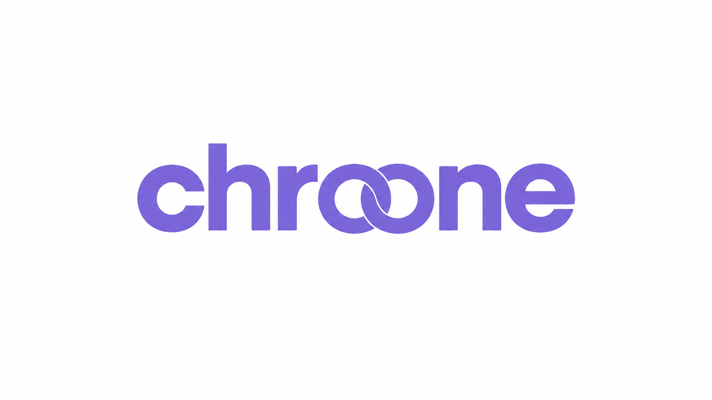

  

<h1 align="center">Chroone (Chronicles One)</h1>

  <strong>Office software, paid once. Source code you own.</strong> 
  Six ready-to-run systems for shops to corporations. Run on your own server, no monthly bills.

  <a href="https://chroone.web.id/">Website</a> ·
  <a href="https://wa.me/6281283031559?text=Hello%20Chroone%2C%20I%20have%20a%20question%20about%20your%20products.">WhatsApp</a> ·
  <a href="mailto:halo@chroone.web.id">halo@chroone.web.id</a>

---

## What is Chroone

Chroone sells complete office systems with full source code transfer. You pay one time per edition, receive the repository on GitHub, deploy on your VPS or on-premise, and operate it independently.

No subscription. No yearly license. No operational data held by us after handover.

Early access opens with **HRIS and POS**. Four more systems follow in the same catalog.

## Products

| Product | What it does | For |
|---|---|---|
| **HRIS** | Payroll with PPh 21 and BPJS, attendance, leave, payslips, employee self-service | HR |
| **POS** | Offline-first cashier, thermal receipts, split bills, automatic daily sales report | Retail, F&B |
| **Inventory** | Multi-warehouse stock cards, periodic counts, low-stock alerts. Plugs into POS and Accounting | Warehouse |
| **Accounting** | Double-entry journals, P&L, balance sheet, cash flow, tax-ready exports | Finance |
| **School / LMS** | Online enrollment, e-reports, QR attendance, tuition billing with auto reminders | Education |
| **E-commerce** | Catalog, cart, checkout with local payment gateways, order dashboard with shipping | Online Store |

All products are listed at [chroone.web.id](https://chroone.web.id/#products). Prices start from the UMKM edition.

## Editions

Same system for every office size. Only capacity and handover support differ.

| | UMKM | Business | Professional |
|---|---|---|---|
| Best for | Small shops that need tidy systems | Growing multi-branch companies | Corporates and institutions |
| Capacity | 1 branch, up to 10 users | Multi-branch, up to 50 users | Unlimited users |
| Starting price | From Rp10 jt, one payment | From Rp35 jt, one payment | From Rp75 jt, one payment |
| Code | Full source + deploy guide | Source + API docs | Source + code audit and architecture review |
| Deploy | Self deploy with guide | Remote deploy assistance | Assisted on-premise deploy |
| Updates | 6 months minor updates | 1 year minor updates | Priority updates |
| Support | 30-day WhatsApp | 90-day support | 1-year SLA |

Discuss an edition on WhatsApp: [UMKM](https://wa.me/6281283031559?text=Hello%20Chroone%2C%20I%27d%20like%20to%20discuss%20the%20UMKM%20edition.) · [Business](https://wa.me/6281283031559?text=Hello%20Chroone%2C%20I%27d%20like%20to%20discuss%20the%20Business%20edition.) · [Professional](https://wa.me/6281283031559?text=Hello%20Chroone%2C%20I%27d%20like%20to%20discuss%20the%20Professional%20edition.)

## How buying works

1. **Chat about your needs.** Tell us office size, user count, and current system.
2. **Receive a written quote.** Price, license terms, and support window in writing.
3. **Pay once.** Transfer to the company account and sign the license. Invoice under your office name.
4. **Repo changes hands.** GitHub invite and handover session after the license is signed.
5. **Runs on your server.** Deploy on VPS or on-premise. From there the system is fully yours.

Replies within 24 hours. No commitment required to ask.

## What you receive

Every edition includes the complete runnable system:

* Application source code
* Database migration schemas
* `docker-compose.yml` for self hosting
* README with deploy and operate steps

Your team can read, change, and redeploy without us. Resale is excluded by license. Add-ons and custom changes are quoted separately.

## Own vs rent

Example: HRIS Business at Rp35 jt versus typical SaaS at Rp2 jt per month.

* Month 12: Rp35 jt vs Rp24 jt
* Month 18: cost lines cross
* Month 36: Rp35 jt vs Rp72 jt, you keep Rp37 jt

Chroone stays flat after the one-time payment. SaaS keeps billing.

## FAQ

**Do we really get the source code?**
Yes. Full repo transfer to your GitHub org, including app, database schemas, and deploy files.

**Can our team modify the code?**
Yes. Modify freely for internal use. Resale is not permitted.

**Any monthly or yearly fees?**
No. Edition price is paid once. Year two onward is Rp0 to keep running.

**Can it run on our own server?**
Yes. VPS or on-premise. We hold no operational data after handover.

**What if there is a bug?**
Covered inside your support window. Patches land in your repo. After the window, fixes can be ordered as add-ons.

Full FAQ: [chroone.web.id](https://chroone.web.id/#faq)

## Contact

* Website: [https://chroone.web.id/](https://chroone.web.id/)
* WhatsApp: [+62 812-8303-1559](https://wa.me/6281283031559?text=Hello%20Chroone%2C%20I%27d%20like%20to%20talk%20about%20your%20software.)
* Email: [halo@chroone.web.id](mailto:halo@chroone.web.id)

Include business type, user count, and current system so the answer fits.

---

  <strong>Don't rent software. Own it.</strong> 
  © Chroone (Chronicles One). All rights reserved.

